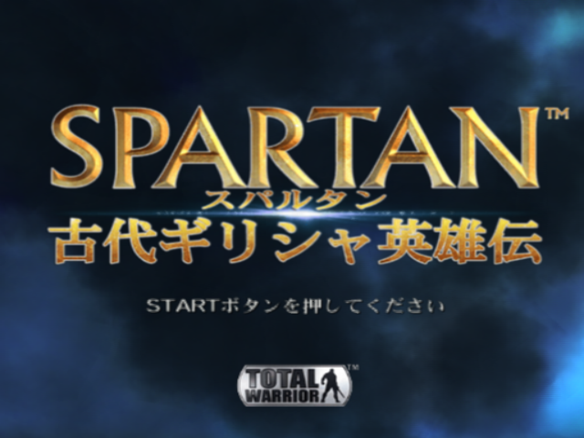
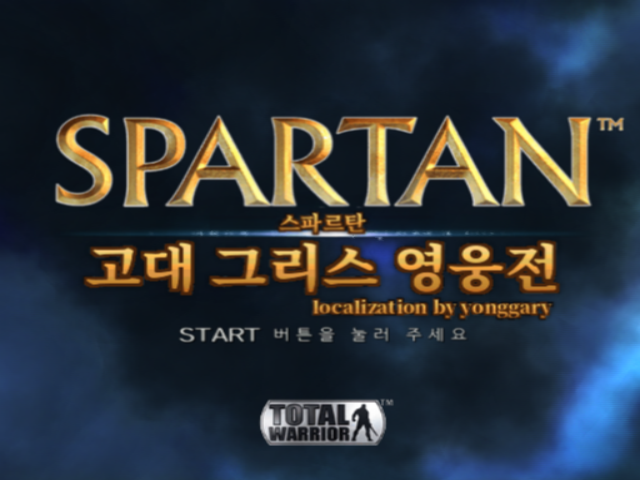
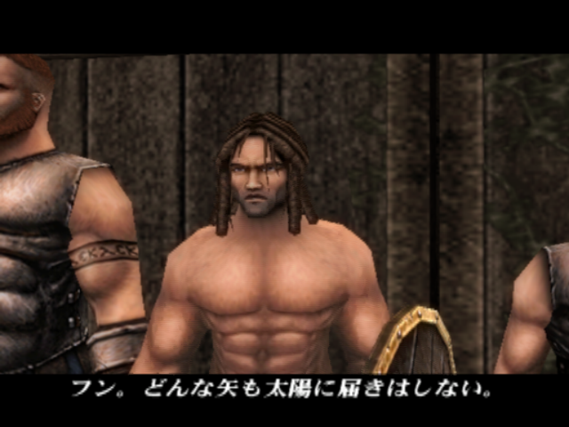
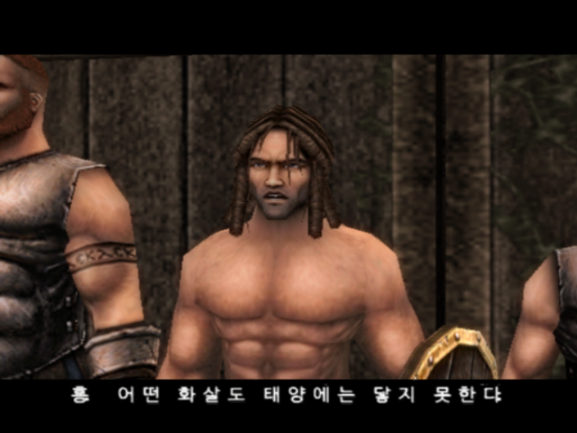
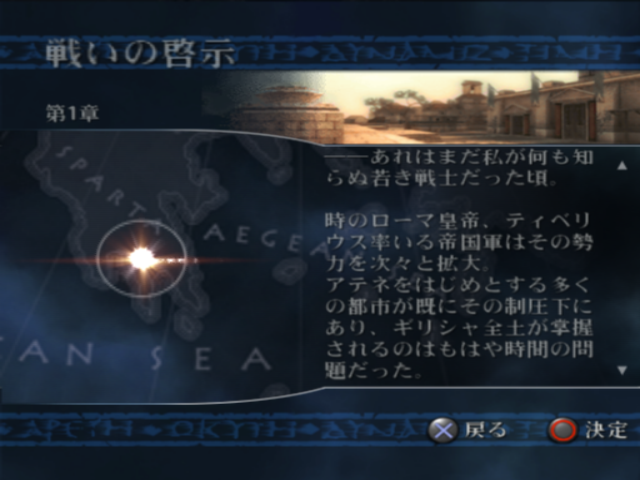
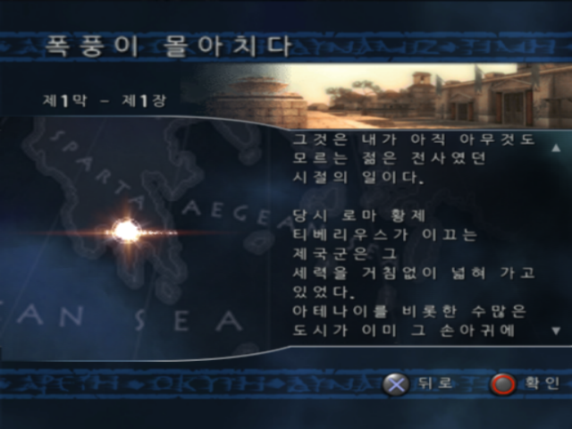

# 스파르탄 ~고대 그리스 영웅전~ 한글패치 (PS2 일본판)

**Spartan: Total Warrior** 일본판 『スパルタン ～古代ギリシャ英雄伝～』(SLPM-66444) 한글패치입니다.

> 본 한글패치는 개인이 제작한 비공식·비상업적 팬 한글패치입니다. — by **Yonggary6425 (용가리)**
> 게임 이미지(ISO)는 포함되어 있지 않습니다. 직접 소유한 원본으로만 사용해 주세요.

| 원본 일본판 | 한글패치 v1.0 |
|---|---|
|  |  |
|  |  |
|  |  |

---

## 주요 특징

- **일본어 전체 한글화**: 게임 안 일본어 문장 3,645항목 전부 (남은 일본어 0건)
- **일본어 음성 기준 번역**: 대사·컷신 자막·목표·미션 설명 2,030항목을 영어 대본이 아닌 **일본어 음성(자막)에 맞춰** 번역했습니다. 화면 자막과 들리는 음성의 내용이 일치합니다.
- **고풍스러운 서사체**: 그리스 인물·지명은 그리스어 원음(카스토르, 폴리데우케스, 아테나이, 트로이아, 헬라스), 로마 인물은 라틴어 원음(티베리우스, 세야누스)
- **시스템 안내는 해요체**: "START 버튼을 눌러 주세요", "원정을 시작해요!"
- **적 이름표 한글화**: 일본판에서도 라틴어였던 적 이름(Aulus Laetus → 아울루스 라이투스) 구성 요소 1,581개
- **영문 잔존 항목 한글화**: 난이도, 전투 평가, ON/OFF, 제작진 직함 등 142항목
- **나눔바른고딕 글꼴**, 원본에 맞춘 크기, 실시간 컷신 자막 기울임 제거
- 타이틀 로고 한글화, 한글화 크레딧 화면, `localization by yonggary` 표기

자세한 원본 비교는 [`docs/스파르탄_한글패치현황_20261116_v1.0.pdf`](docs/) 를 참고하세요.

---

## 준비물

- PS2 일본판 원본 ISO: **Spartan - Kodai Greece Eiyuuden (Japan)** / **SLPM-66444**
  - 크기 1,336,573,952 바이트 (제작에 쓴 원본 기준)
  - 파일 단위 MD5를 검사하므로, 내용이 같은 원본이면 덤프 방식과 상관없이 적용됩니다.
- Windows 10/11 (추가 설치 없음) 또는 Python 3.8 이상

## 적용 방법

[Releases](../../releases) 에서 `Spartan_KOR_Patch_v1.0.zip` 을 받아 압축을 풉니다.

### A. ISO에 적용 (권장)

1. 원본 ISO 파일을 **`패치하기.bat`** 위에 끌어다 놓습니다.
2. 같은 폴더에 **`원본이름 (Korean).iso`** 가 새로 생깁니다. (원본 ISO는 그대로 둡니다)
3. 완료 메시지에 `완료! (25/25 파일)` 이 나오면 성공입니다.

### B. 압축 푼 게임 폴더에 적용

1. 게임 폴더(`SLPM_664.44` 와 `DATA` 폴더가 있는 곳)를 `패치하기.bat` 위에 끌어다 놓습니다.
2. 옆에 `DATA_KOR` 폴더가 생기고 한글 PAK 25개가 들어갑니다.
3. `DATA` 폴더의 같은 이름 파일과 바꾼 뒤 ISO로 다시 묶어 주세요.

### C. Python으로 적용 (macOS / Linux)

```
python3 patch.py "Spartan - Kodai Greece Eiyuuden (Japan).iso"
python3 patch.py "게임폴더"
```

> 패치는 PAK 안의 바뀐 섹터만 덮어쓰며, 모든 파일의 크기와 위치(LBA)는 원본과 같습니다.
> 적용 전후로 MD5를 검사하므로, 원본이 다르면 해당 파일은 건너뛰고 알려 줍니다.

## 주의

- **세이브 스테이트(F3 등)로 불러오면 이전 글꼴·문장이 그대로 보일 수 있습니다.** 세이브 스테이트에는 그 시점의 메모리가 통째로 저장되기 때문입니다. 메모리 카드 세이브로 불러오거나 새로 시작해 주세요.
- 이전 버전 패치본에 다시 적용하지 말고, 항상 **원본 ISO** 에 적용해 주세요.
- 테스트 환경: PCSX2 v2.4 / v2.8.2

## 부록: PCSX2 치트

`cheats/SLPM-66444_26689C87.pnach` — 유럽판(SLES-53393) 치트를 일본판 실행 파일 주소로 이식한 것입니다. 한글패치판에도 그대로 쓸 수 있습니다.

- 사용법: PCSX2 `cheats` 폴더에 복사 → 게임 속성 → 치트에서 원하는 항목 켜기
- 무적, 화살 무한, 적 약화, 미션·아레나·갤러리 해금, HUD 숨기기 등

## 구성 파일

```
patcher/
  패치하기.bat        드래그 앤 드롭 실행 파일 (Windows)
  patch.ps1           적용기 본체 (Windows PowerShell 기본 기능)
  spartan_kor.bin     패치 데이터 (패치하기.bat 용)
  patch.py            Python 적용기
  spartan_kor.patch   패치 데이터 (patch.py 용)
cheats/
  SLPM-66444_26689C87.pnach
docs/
  스파르탄_한글패치현황_20261116_v1.0.pdf
  screenshots/
```

## 번역·표기 원칙

| 구분 | 표기 |
|---|---|
| 그리스 인물·지명 | 카스토르, 폴리데우케스, 레오니다스 왕, 엘렉트라, 아테나이, 트로이아, 헬라스 |
| 로마 인물 | 티베리우스, 세야누스, 크라수스 |
| 용어 | 백인대장(Centurion), 노포(Ballista), 사령병, 해골병 |
| 말투 | 티베리우스 '짐', 세야누스 하게체, 아르키메데스·군신 아레스 고어체 |

## 크레딧

- 한글화·패처 제작: **Yonggary6425 (용가리)**
- 한글 글꼴: 나눔바른고딕 (NAVER, SIL Open Font License 1.1)
- 원작: Spartan: Total Warrior © 2005 The Creative Assembly Ltd. / SEGA. 모든 권리는 원저작권자에게 있습니다.

## 버그 제보

오역·오탈자·표시 문제는 [Issues](../../issues) 에 장면(스테이지·상황)과 스크린샷을 함께 올려 주세요.
